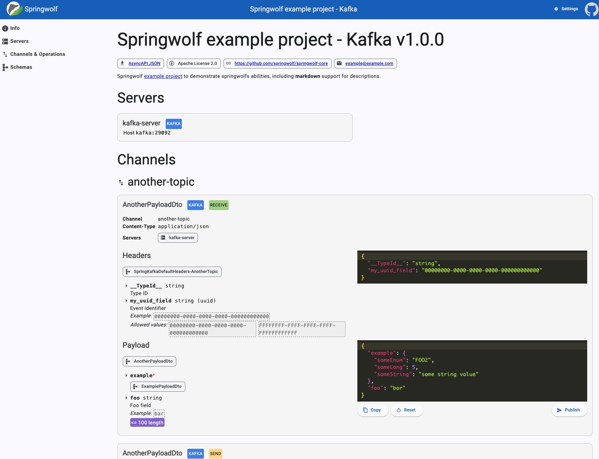
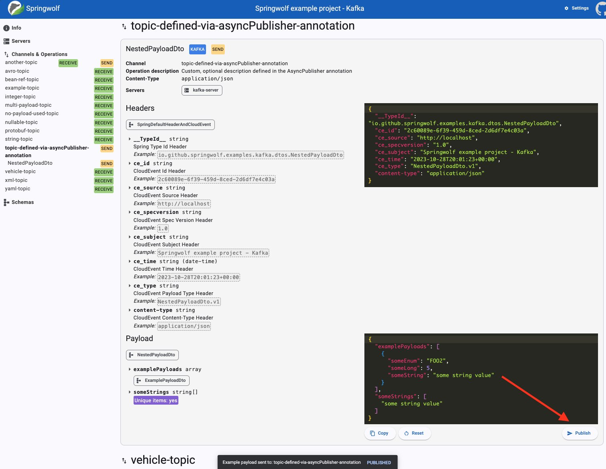
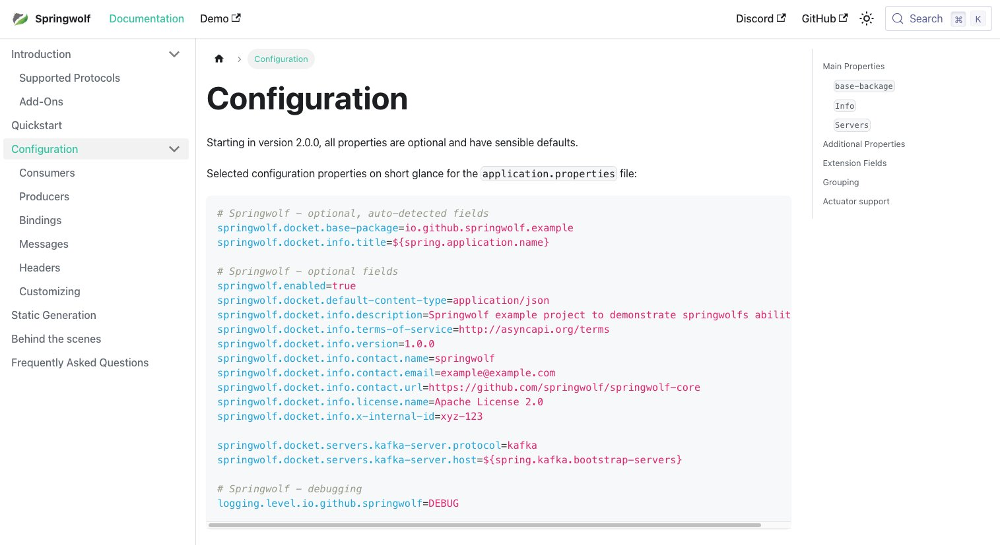

<p align="center">
  <a href="https://github.com/springwolf/springwolf-core/releases"></a>
  <a href="https://opensource.org/licenses/Apache-2.0"></a>
  <a href="https://github.com/springwolf/springwolf-core/actions/workflows/springwolf-core.yml"></a>
  <a href="https://github.com/springwolf/springwolf-core/actions/workflows/springwolf-plugins.yml"></a>
  <a href="https://github.com/springwolf/springwolf-core/actions/workflows/springwolf-ui.yml"></a>
</p>

<h1 align="center">
 Springwolf
</h1>

<p align="center">
<strong>Generate AsyncAPI documentation from your Spring Boot event-driven application</strong>
</p>

<p align="center">
  <a href="https://www.springwolf.dev/docs/quickstart">Get started</a> ·
  <a href="https://demo.springwolf.dev/">Try the demo</a> ·
  <a href="springwolf-examples/springwolf-kafka-example/src/test/resources/asyncapi.json">View a generated AsyncAPI document</a> ·
  <a href="https://www.springwolf.dev/docs">Read the documentation</a> ·
  <a href="https://discord.gg/HZYqd5RPTd">Join Discord</a>
</p>

## What Springwolf does

Springwolf generates an [AsyncAPI](https://www.asyncapi.com/) document from your event-driven Spring application.
For supported brokers, it discovers endpoints from listener annotations such as `@KafkaListener`, `@RabbitListener`, and `@SqsListener`.
It is inspired by [Springfox](https://github.com/springfox/springfox), but focuses on asynchronous APIs rather than HTTP/OpenAPI APIs.

The [generated document](springwolf-examples/springwolf-kafka-example/src/test/resources/asyncapi.json) can be shared as JSON or YAML or integrated into API hubs such as [Backstage](https://backstage.io/docs/features/software-catalog/descriptor-format/).

### `springwolf-ui`

The optional `springwolf-ui` provides a browser UI with example payloads and can publish messages for testing.

| Springwolf UI | Message publishing |
|:---:|:---:|
| <a href="https://demo.springwolf.dev/"></a> | <a href="https://demo.springwolf.dev"></a> |
| [Click to try the demo](https://demo.springwolf.dev/) | Due to security concerns, publishing must be enabled in the configuration |

## Supported integrations

All Springwolf plugins, artifacts, bindings, and add-ons use the same version.
Use the release or snapshot version shown here for every artifact listed below.

[](https://central.sonatype.com/artifact/io.github.springwolf/springwolf-core)
[](https://central.sonatype.com/repository/maven-snapshots/io/github/springwolf/springwolf-core/)

| Integration | Detected listeners / endpoints | Artifact | Example |
|---|---|---|---|
| [AMQP](https://github.com/springwolf/springwolf-core/tree/main/springwolf-plugins/springwolf-amqp-plugin) | `@RabbitListener` | `io.github.springwolf:springwolf-amqp` | [Example code](https://github.com/springwolf/springwolf-core/tree/main/springwolf-examples/springwolf-amqp-example) |
| [AWS SNS](https://github.com/springwolf/springwolf-core/tree/main/springwolf-plugins/springwolf-sns-plugin) | N/A | `io.github.springwolf:springwolf-sns` | [Example code](https://github.com/springwolf/springwolf-core/tree/main/springwolf-examples/springwolf-sns-example) |
| [AWS SQS](https://github.com/springwolf/springwolf-core/tree/main/springwolf-plugins/springwolf-sqs-plugin) | `@SqsListener` | `io.github.springwolf:springwolf-sqs` | [Example code](https://github.com/springwolf/springwolf-core/tree/main/springwolf-examples/springwolf-sqs-example) |
| [Cloud Stream](https://github.com/springwolf/springwolf-core/tree/main/springwolf-plugins/springwolf-cloud-stream-plugin) | Functional `@Bean` | `io.github.springwolf:springwolf-cloud-stream` | [Example code](https://github.com/springwolf/springwolf-core/tree/main/springwolf-examples/springwolf-cloud-stream-example) |
| [JMS](https://github.com/springwolf/springwolf-core/tree/main/springwolf-plugins/springwolf-jms-plugin) | `@JmsListener` | `io.github.springwolf:springwolf-jms` | [Example code](https://github.com/springwolf/springwolf-core/tree/main/springwolf-examples/springwolf-jms-example) |
| [Kafka](https://github.com/springwolf/springwolf-core/tree/main/springwolf-plugins/springwolf-kafka-plugin) | `@KafkaListener`, `@KafkaHandler` | `io.github.springwolf:springwolf-kafka` | [Example code](https://github.com/springwolf/springwolf-core/tree/main/springwolf-examples/springwolf-kafka-example) |
| [STOMP / WebSocket](https://github.com/springwolf/springwolf-core/tree/main/springwolf-plugins/springwolf-stomp-plugin) | `@MessageMapping`, `@SendTo`, `@SendToUser` | `io.github.springwolf:springwolf-stomp` | [Example code](https://github.com/springwolf/springwolf-core/tree/main/springwolf-examples/springwolf-stomp-example) |

For protocols without native listener detection, document consumers and publishers with [`@AsyncListener` and `@AsyncPublisher`](https://www.springwolf.dev/docs/configuration/documenting-consumers).

## Quick start

For a Spring Boot application using Kafka, add the Springwolf Kafka plugin:

```groovy
dependencies {
    implementation 'io.github.springwolf:springwolf-kafka:<springwolf-version>'
    implementation 'io.github.springwolf:springwolf-ui:<springwolf-version>' // optional
}
```

At startup, Springwolf scans your application for supported listener and publisher annotations (such as `@KafkaListener`) and generates an AsyncAPI document at `/springwolf/docs`.
Alternatively use the standalone mode to generate or verify an existing AsyncAPI document [as part of your tests](springwolf-examples/springwolf-kafka-example/src/test/java/io/github/springwolf/examples/kafka/StandaloneTest.java).

Use `springwolf-ui` to browse the document in a UI at `/springwolf/asyncapi-ui.html`.

### Configuration

Configuration has sensible defaults, but can be adjusted.
See the [configuration reference](https://www.springwolf.dev/docs/configuration) for details.


<p align="center">
  <a href="https://www.springwolf.dev/docs/configuration">
    
  </a>
</p>

## Releases

Browse [GitHub releases](https://github.com/springwolf/springwolf-core/releases) for release notes, changes, and migration guidance.

### Artifacts

Further artifacts apart from the integration plugins above:

| Artifact | Contents |
|---|---|
| `io.github.springwolf:springwolf-asyncapi` | JVM model and builders for the AsyncAPI specification. |
| `io.github.springwolf:springwolf-core` | Spring integration that scans endpoints and generates the AsyncAPI document. |
| `io.github.springwolf:springwolf-ui` | Browser UI for viewing the generated document and example payloads. |
| `io.github.springwolf:springwolf-bindings` | Annotations and models for protocol-specific AsyncAPI bindings. |
| `io.github.springwolf:springwolf-common-model-converters` | Shared converters for mapping Java types to AsyncAPI schemas. |
| `io.github.springwolf:springwolf-json-schema` | Adds JSON Schema representations to detected AsyncAPI schemas. |
| `io.github.springwolf:springwolf-kotlinx-serialization-model-converter` | Converts Kotlinx-serialized classes to AsyncAPI schemas, including `@SerialName` values. |

### Compatibility

The current release line targets Spring Boot 4.

| Spring Boot | Springwolf versions | Support status |
|---|---|---|
| 4.x | 2.x | Current release line |
| 3.x | Up to 1.20.0 | Legacy; no further updates |
| 2.x | Older, plugin-specific versions | [Legacy; no further updates](https://www.springwolf.dev/docs/faq#is-spring-boot-2x-supported) |

### Using `SNAPSHOT` version


For Sonatype snapshots, add the snapshot repository to your Gradle build:

```groovy
repositories {
    // ...
    maven {
        url "https://central.sonatype.com/repository/maven-snapshots/" // build.gradle
        // url = uri("https://central.sonatype.com/repository/maven-snapshots/") // build.gradle.kts
    }
}
```

For Maven, add the snapshot repository to your `pom.xml`:

```xml
<repositories>
    <repository>
        <id>oss-sonatype</id>
        <name>oss-sonatype</name>
        <url>https://central.sonatype.com/repository/maven-snapshots/</url>
        <snapshots>
            <enabled>true</enabled>
        </snapshots>
    </repository>
</repositories>
```

For local builds, run the `publishToMavenLocal` Gradle task.

The current version number is set in the [`.env`](.env) file.

Add `mavenLocal()` to the `repositories` section.

## Help and contributing

For setup problems, see the [FAQ](https://www.springwolf.dev/docs/faq), including [UI troubleshooting](https://www.springwolf.dev/docs/faq#the-springwolf-ui-isnt-showing).

To report a bug or request a feature, [open an issue](https://github.com/springwolf/springwolf-core/issues); for questions and discussion, [join Discord](https://discord.gg/HZYqd5RPTd).

To contribute, start with the [contribution guide](CONTRIBUTING.md).

## Contributors

<!-- ALL-CONTRIBUTORS-LIST:START - Do not remove or modify this section -->
<!-- prettier-ignore-start -->
<!-- markdownlint-disable -->
<table>
  <tbody>
    <tr>
      <td align="center" valign="top" width="14.28%"><a href="https://stavshamir.github.io/"><br /><sub><b>Stav Shamir</b></sub></a><br /><a href="https://github.com/stavshamir/Springwolf/commits?author=stavshamir" title="Code">💻</a></td>
      <td align="center" valign="top" width="14.28%"><a href="https://github.com/timonback"><br /><sub><b>Timon Back</b></sub></a><br /><a href="https://github.com/stavshamir/Springwolf/commits?author=timonback" title="Code">💻</a></td>
      <td align="center" valign="top" width="14.28%"><a href="https://github.com/sam0r040"><br /><sub><b>sam0r040</b></sub></a><br /><a href="https://github.com/stavshamir/Springwolf/commits?author=sam0r040" title="Code">💻</a></td>
      <td align="center" valign="top" width="14.28%"><a href="https://github.com/ctasada"><br /><sub><b>Carlos Tasada</b></sub></a><br /><a href="https://github.com/stavshamir/Springwolf/commits?author=ctasada" title="Code">💻</a></td>
      <td align="center" valign="top" width="14.28%"><a href="https://github.com/jrlambs"><br /><sub><b>jrlambs</b></sub></a><br /><a href="https://github.com/stavshamir/Springwolf/commits?author=jrlambs" title="Code">💻</a></td>
      <td align="center" valign="top" width="14.28%"><a href="https://github.com/DmitriButorchin"><br /><sub><b>DmitriButorchin</b></sub></a><br /><a href="https://github.com/stavshamir/Springwolf/commits?author=DmitriButorchin" title="Code">💻</a></td>
      <td align="center" valign="top" width="14.28%"><a href="https://github.com/tvahrst"><br /><sub><b>Thomas Vahrst</b></sub></a><br /><a href="https://github.com/stavshamir/Springwolf/commits?author=tvahrst" title="Code">💻</a></td>
    </tr>
    <tr>
      <td align="center" valign="top" width="14.28%"><a href="https://github.com/yasen-pavlov"><br /><sub><b>Yasen Pavlov</b></sub></a><br /><a href="https://github.com/stavshamir/Springwolf/commits?author=yasen-pavlov" title="Code">💻</a></td>
      <td align="center" valign="top" width="14.28%"><a href="https://www.ageweiler.de/"><br /><sub><b>Arthur Geweiler</b></sub></a><br /><a href="https://github.com/stavshamir/Springwolf/commits?author=harare" title="Code">💻</a></td>
      <td align="center" valign="top" width="14.28%"><a href="https://github.com/CS-BASF"><br /><sub><b>CS-BASF</b></sub></a><br /><a href="https://github.com/stavshamir/Springwolf/commits?author=CS-BASF" title="Code">💻</a></td>
      <td align="center" valign="top" width="14.28%"><a href="https://vanwilgenburg.wordpress.com/"><br /><sub><b>Jeroen van Wilgenburg</b></sub></a><br /><a href="https://github.com/stavshamir/Springwolf/commits?author=jvwilge" title="Code">💻</a></td>
      <td align="center" valign="top" width="14.28%"><a href="https://github.com/strelchm"><br /><sub><b>Michael Strelchenko</b></sub></a><br /><a href="https://github.com/stavshamir/Springwolf/commits?author=strelchm" title="Code">💻</a></td>
      <td align="center" valign="top" width="14.28%"><a href="https://github.com/ogaudefroy"><br /><sub><b>Olivier Gaudefroy</b></sub></a><br /><a href="https://github.com/stavshamir/Springwolf/commits?author=ogaudefroy" title="Code">💻</a></td>
      <td align="center" valign="top" width="14.28%"><a href="https://github.com/Omerbea"><br /><sub><b>Omerbea</b></sub></a><br /><a href="https://github.com/stavshamir/Springwolf/commits?author=Omerbea" title="Code">💻</a></td>
    </tr>
    <tr>
      <td align="center" valign="top" width="14.28%"><a href="https://www.linkedin.com/in/pavel-bo/"><br /><sub><b>Pavel Bodiachevskii</b></sub></a><br /><a href="https://github.com/stavshamir/Springwolf/commits?author=Pakisan" title="Code">💻</a></td>
      <td align="center" valign="top" width="14.28%"><a href="https://github.com/sergiorc"><br /><sub><b>Sergio Roldán</b></sub></a><br /><a href="https://github.com/stavshamir/Springwolf/commits?author=sergiorc" title="Code">💻</a></td>
      <td align="center" valign="top" width="14.28%"><a href="https://github.com/Stmated"><br /><sub><b>Stmated</b></sub></a><br /><a href="https://github.com/stavshamir/Springwolf/commits?author=Stmated" title="Code">💻</a></td>
      <td align="center" valign="top" width="14.28%"><a href="https://github.com/themis-pyrgiotis"><br /><sub><b>Themistoklis Pyrgiotis</b></sub></a><br /><a href="https://github.com/stavshamir/Springwolf/commits?author=themis-pyrgiotis" title="Code">💻</a></td>
      <td align="center" valign="top" width="14.28%"><a href="https://github.com/ZachHubbs"><br /><sub><b>Zach Hubbs</b></sub></a><br /><a href="https://github.com/stavshamir/Springwolf/commits?author=ZachHubbs" title="Code">💻</a></td>
      <td align="center" valign="top" width="14.28%"><a href="https://github.com/biergit"><br /><sub><b>biergit</b></sub></a><br /><a href="https://github.com/stavshamir/Springwolf/commits?author=biergit" title="Code">💻</a></td>
      <td align="center" valign="top" width="14.28%"><a href="https://github.com/kalarani"><br /><sub><b>kalarani</b></sub></a><br /><a href="https://github.com/stavshamir/Springwolf/commits?author=kalarani" title="Code">💻</a></td>
    </tr>
    <tr>
      <td align="center" valign="top" width="14.28%"><a href="https://dipeshsingh253.github.io/"><br /><sub><b>Dipesh Singh</b></sub></a><br /><a href="https://github.com/stavshamir/Springwolf/commits?author=dipeshsingh253" title="Code">💻</a></td>
      <td align="center" valign="top" width="14.28%"><a href="https://github.com/Sakshi-75"><br /><sub><b>Sakshi Jain</b></sub></a><br /><a href="https://github.com/stavshamir/Springwolf/commits?author=Sakshi-75" title="Code">💻</a></td>
      <td align="center" valign="top" width="14.28%"><a href="https://github.com/SheheryarAamir"><br /><sub><b>Sheheryar Aamir</b></sub></a><br /><a href="https://github.com/stavshamir/Springwolf/commits?author=SheheryarAamir" title="Code">💻</a></td>
      <td align="center" valign="top" width="14.28%"><a href="https://github.com/jmwestbe"><br /><sub><b>jmwestbe</b></sub></a><br /><a href="https://github.com/stavshamir/Springwolf/commits?author=jmwestbe" title="Code">💻</a></td>
      <td align="center" valign="top" width="14.28%"><a href="https://github.com/pdalfarr"><br /><sub><b>pdalfarr</b></sub></a><br /><a href="https://github.com/stavshamir/Springwolf/commits?author=pdalfarr" title="Code">💻</a></td>
      <td align="center" valign="top" width="14.28%"><a href="https://github.com/krzysztofxkwiecien"><br /><sub><b>Krzysztof Kwiecień</b></sub></a><br /><a href="https://github.com/stavshamir/Springwolf/commits?author=krzysztofxkwiecien" title="Code">💻</a></td>
      <td align="center" valign="top" width="14.28%"><a href="https://github.com/robert-henke"><br /><sub><b>Robert Henke</b></sub></a><br /><a href="https://github.com/stavshamir/Springwolf/commits?author=robert-henke" title="Code">💻</a></td>
    </tr>
    <tr>
      <td align="center" valign="top" width="14.28%"><a href="https://raphaeldelio.com/"><br /><sub><b>Raphael De Lio</b></sub></a><br /><a href="https://github.com/stavshamir/Springwolf/commits?author=raphaeldelio" title="Code">💻</a></td>
      <td align="center" valign="top" width="14.28%"><a href="https://github.com/aerfus"><br /><sub><b>Nikita Marunko</b></sub></a><br /><a href="https://github.com/stavshamir/Springwolf/commits?author=aerfus" title="Code">💻</a></td>
      <td align="center" valign="top" width="14.28%"><a href="https://www.linkedin.com/in/victor-levitskiy-561956114/"><br /><sub><b>Victor Levitskiy</b></sub></a><br /><a href="https://github.com/stavshamir/Springwolf/commits?author=victorlev01" title="Code">💻</a></td>
      <td align="center" valign="top" width="14.28%"><a href="https://github.com/ccudennec-otto"><br /><sub><b>Christopher Cudennec</b></sub></a><br /><a href="https://github.com/stavshamir/Springwolf/commits?author=ccudennec-otto" title="Code">💻</a></td>
      <td align="center" valign="top" width="14.28%"><a href="https://github.com/dabeck81"><br /><sub><b>dabeck81</b></sub></a><br /><a href="https://github.com/stavshamir/Springwolf/commits?author=dabeck81" title="Code">💻</a></td>
      <td align="center" valign="top" width="14.28%"><a href="https://www.janmarten.dev/"><br /><sub><b>Jan Marten</b></sub></a><br /><a href="https://github.com/stavshamir/Springwolf/commits?author=LeovR" title="Code">💻</a></td>
      <td align="center" valign="top" width="14.28%"><a href="https://github.com/FabianBesner2020"><br /><sub><b>FabianBesner2020</b></sub></a><br /><a href="https://github.com/stavshamir/Springwolf/commits?author=FabianBesner2020" title="Code">💻</a></td>
    </tr>
    <tr>
      <td align="center" valign="top" width="14.28%"><a href="https://github.com/nwwerum"><br /><sub><b>Norbert Wirges</b></sub></a><br /><a href="https://github.com/stavshamir/Springwolf/commits?author=nwwerum" title="Code">💻</a></td>
      <td align="center" valign="top" width="14.28%"><a href="https://github.com/ttulka"><br /><sub><b>Tomas Tulka</b></sub></a><br /><a href="https://github.com/stavshamir/Springwolf/commits?author=ttulka" title="Code">💻</a></td>
      <td align="center" valign="top" width="14.28%"><a href="https://github.com/elysrivero99"><br /><sub><b>Elys Rivero</b></sub></a><br /><a href="https://github.com/stavshamir/Springwolf/commits?author=elysrivero99" title="Code">💻</a></td>
      <td align="center" valign="top" width="14.28%"><a href="https://github.com/AlexElin"><br /><sub><b>AlexElin</b></sub></a><br /><a href="https://github.com/stavshamir/Springwolf/commits?author=AlexElin" title="Code">💻</a></td>
      <td align="center" valign="top" width="14.28%"><a href="https://github.com/antoine-vaisset-pro"><br /><sub><b>antoine VAISSET</b></sub></a><br /><a href="https://github.com/stavshamir/Springwolf/commits?author=antoine-vaisset-pro" title="Code">💻</a></td>
      <td align="center" valign="top" width="14.28%"><a href="https://github.com/Karlender"><br /><sub><b>Karlender</b></sub></a><br /><a href="https://github.com/stavshamir/Springwolf/commits?author=Karlender" title="Code">💻</a></td>
      <td align="center" valign="top" width="14.28%"><a href="https://github.com/sge93"><br /><sub><b>Steffen</b></sub></a><br /><a href="https://github.com/stavshamir/Springwolf/commits?author=sge93" title="Code">💻</a></td>
    </tr>
    <tr>
      <td align="center" valign="top" width="14.28%"><a href="https://github.com/risingcult"><br /><sub><b>risingcult</b></sub></a><br /><a href="https://github.com/stavshamir/Springwolf/commits?author=risingcult" title="Code">💻</a></td>
      <td align="center" valign="top" width="14.28%"><a href="https://github.com/HamzehAdawi"><br /><sub><b>Hamzeh Adawi</b></sub></a><br /><a href="https://github.com/stavshamir/Springwolf/commits?author=HamzehAdawi" title="Code">💻</a></td>
      <td align="center" valign="top" width="14.28%"><a href="https://github.com/Haisia"><br /><sub><b>Haisia</b></sub></a><br /><a href="https://github.com/stavshamir/Springwolf/commits?author=Haisia" title="Code">💻</a></td>
      <td align="center" valign="top" width="14.28%"><a href="http://blog.etrandafir.com/"><br /><sub><b>Emanuel Trandafir</b></sub></a><br /><a href="https://github.com/stavshamir/Springwolf/commits?author=etrandafir93" title="Code">💻</a></td>
      <td align="center" valign="top" width="14.28%"><a href="https://github.com/therev2"><br /><sub><b>Revan Channa</b></sub></a><br /><a href="https://github.com/stavshamir/Springwolf/commits?author=therev2" title="Code">💻</a></td>
      <td align="center" valign="top" width="14.28%"><a href="https://github.com/Markus-Sky"><br /><sub><b>Skypha</b></sub></a><br /><a href="https://github.com/stavshamir/Springwolf/commits?author=Markus-Sky" title="Code">💻</a></td>
      <td align="center" valign="top" width="14.28%"><a href="https://github.com/Adrien-dev25"><br /><sub><b>Adrien-dev25</b></sub></a><br /><a href="https://github.com/stavshamir/Springwolf/commits?author=Adrien-dev25" title="Code">💻</a></td>
    </tr>
    <tr>
      <td align="center" valign="top" width="14.28%"><a href="https://github.com/itsmib"><br /><sub><b>Noorul Misbah</b></sub></a><br /><a href="https://github.com/stavshamir/Springwolf/commits?author=itsmib" title="Code">💻</a></td>
      <td align="center" valign="top" width="14.28%"><a href="https://github.com/AZapata27"><br /><sub><b>Andres Zapata</b></sub></a><br /><a href="https://github.com/stavshamir/Springwolf/commits?author=AZapata27" title="Code">💻</a></td>
    </tr>
  </tbody>
</table>

<!-- markdownlint-restore -->
<!-- prettier-ignore-end -->

<!-- ALL-CONTRIBUTORS-LIST:END -->
